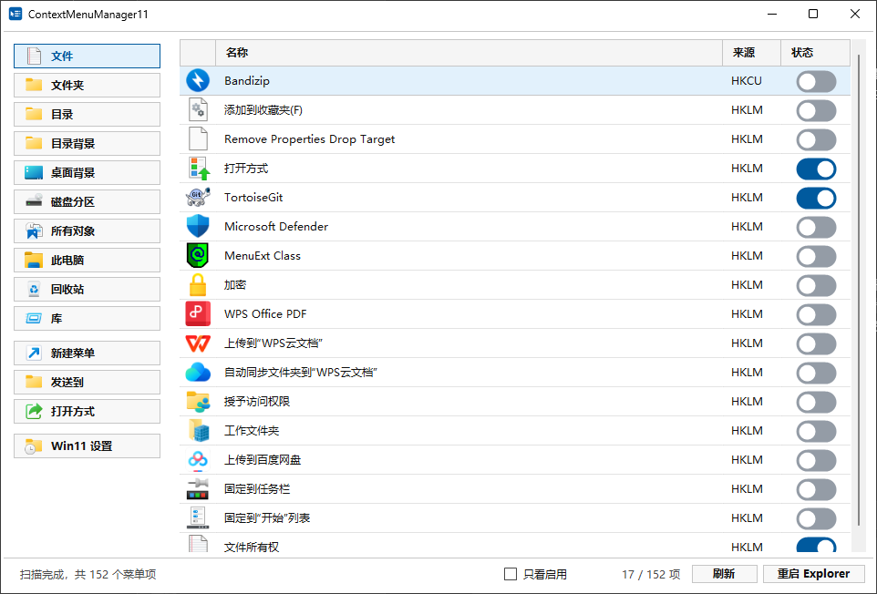

# ContextMenuManager11

ContextMenuManager11 是一个面向 Windows 11 的本地右键菜单管理工具，用更直观的名称、图标和开关整理 Explorer 右键菜单。

## 界面预览

## 功能

- 分别查看文件、文件夹、目录空白处、桌面背景、磁盘、此电脑、回收站和库等位置的右键菜单
- 显示菜单名称、真实图标、来源和当前状态，减少 CLSID、资源编号和内部名称带来的干扰
- 启用或禁用常见的 Shell、ShellEx 右键菜单项目
- 管理“新建”“发送到”和“打开方式”菜单
- 显示“查看”“排序方式”“分组依据”“刷新”等 Explorer 内置项目
- 尽量按照 Explorer 的注册顺序和位置规则排列菜单
- 支持“只看启用”，快速找出当前实际生效的项目
- 查看命令、程序路径、CLSID 和注册表位置等详细信息
- 切换 Windows 11 经典完整右键菜单
- 一键重启 Explorer，让修改立即生效

## 下载与使用

前往 [Releases](https://github.com/BeyondXinXin/ContextMenuManager11/releases/latest) 下载最新版本，解压后运行 `ContextMenuManager11.exe`。

程序需要管理员权限，以便读取和修改系统级右键菜单。支持 Windows 11 x64。

## 说明

- 本工具通过注册表和系统配置管理右键菜单，不会向 Explorer 注入代码，也不会安装额外的 Shell Extension。
- Explorer 运行时生成的菜单会标记为“系统”，这类项目可以查看，但不能单独关闭。
- 部分第三方扩展会在运行时动态决定名称和位置，因此列表顺序可能与实际菜单存在少量差异。
- 删除静态菜单项无法由本工具自动撤销；不确定时建议只使用启用或禁用。
